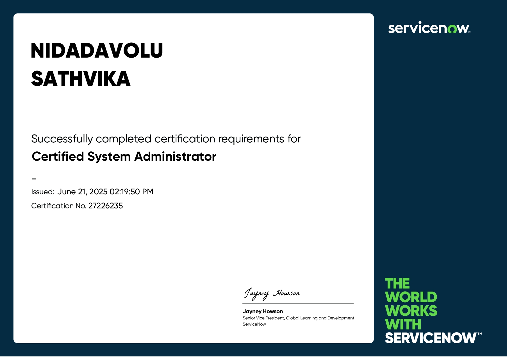
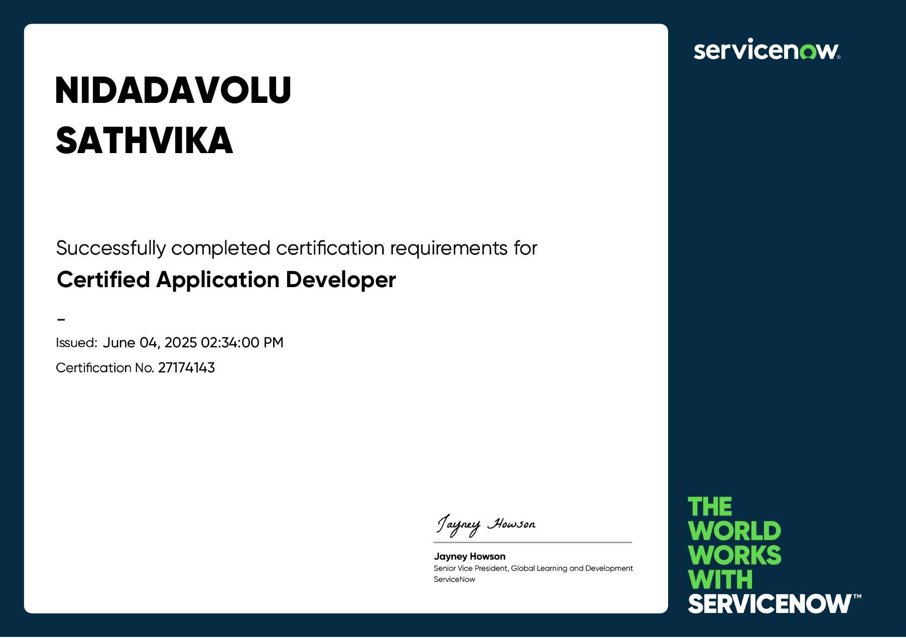
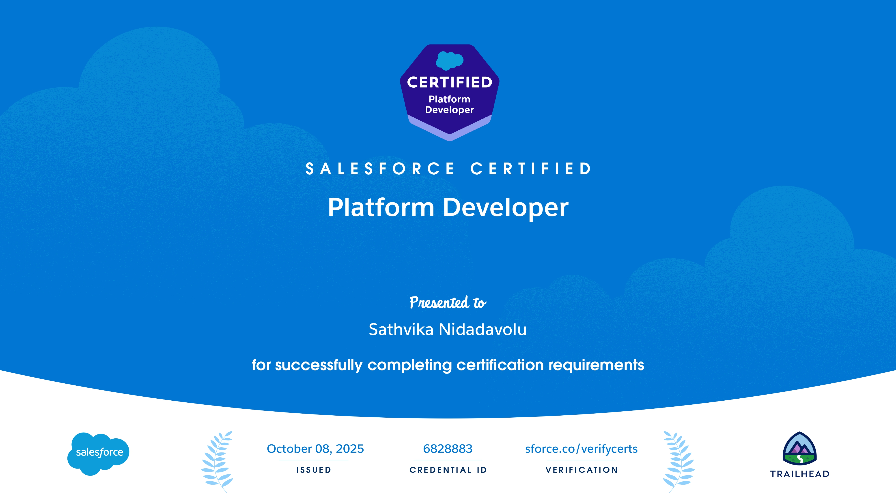

# Hi, I'm Sathvika Nidadavolu 👋

### Software Developer | AI/ML Enthusiast | ServiceNow & Salesforce Developer

I'm a Computer Science Engineering graduate (AI & ML specialization) passionate about building practical software solutions, exploring Artificial Intelligence, and developing scalable applications.

I enjoy working with Java, Python, Data Analytics, AI/ML, and enterprise platforms like ServiceNow and Salesforce. I continuously strengthen my problem-solving skills and explore new technologies through hands-on projects.

---

## 🚀 About Me

- 💻 Interested in Software Development, AI/ML and Data Analytics.
- 🐍 Working with Python, NumPy, Pandas, Matplotlib and Seaborn.
- 🤖 Exploring Machine Learning, Deep Learning and Generative AI.
- ☁️ ServiceNow Certified Application Developer and System Administrator.
- ⚡ Salesforce Certified Platform Developer.
- 🧩 Practicing Data Structures & Algorithms.
- 🌱 Continuously learning and building real-world projects.

---

## 🛠️ Technical Skills

### Programming Languages

### Data Analytics & Visualization

### AI / Machine Learning

### Web Development

### Database & Developer Tools

### Enterprise Platforms

---

## 💡 Featured Projects

### 🤖 AI / Machine Learning & Generative AI

| Project | Description | Technologies |
|---|---|---|
| **Policy Assistant – RAG Based AI Application** | An AI-powered assistant that retrieves relevant information from policy documents and generates context-aware answers using Retrieval-Augmented Generation (RAG). | Python, RAG, OpenAI API, FastAPI |
| **Deepfake Detection System** | Detects manipulated media using deep learning architectures and image analysis techniques. | Python, CNN, ResNet152, EfficientNetV2, OpenCV |
| **Leaf Disease Detection** | Classifies plant leaf diseases using deep learning and image processing. | Python, CNN, TensorFlow |
| **Emotion Detection** | Detects facial emotions using computer vision and facial analysis. | Python, OpenCV, DeepFace |

### ☁️ ServiceNow & Salesforce

| Project | Description | Technologies |
|---|---|---|
| **Employee Onboarding** | Streamlines employee onboarding processes through enterprise workflow automation. | ServiceNow |
| **Gadget Store Service Catalog** | Created a service catalog with Wearables, Smartphones, Earbuds, catalog items, variables and order guides. | ServiceNow |
| **Smart Parking System** | A smart parking solution focused on managing parking availability and streamlining parking operations. | Project-specific technologies |
| **Application Role Tracker** | Salesforce application to manage internal role applications with automated screening, notifications, reports and dashboards. | Salesforce, Flows, Custom Objects |

### 🌐 Web Development

| Project | Description | Technologies |
|---|---|---|
| **Carbon Footprint Calculator** | Calculates household carbon footprint through an interactive interface. | HTML, CSS, JavaScript, D3.js |
| **Pencil Sketch Generator** | Converts ordinary photographs into pencil sketch artwork. | Python, OpenCV |

---

## 📊 Data Analytics & Python Learning

Currently expanding my skills in Python programming, data analysis and visualization.

- **NumPy:** Numerical computing and array operations.
- **Pandas:** Data manipulation, cleaning and analysis.
- **Matplotlib:** Data visualization and plotting.
- **Seaborn:** Statistical visualization and exploratory data analysis.
- **BeautifulSoup:** Web scraping and data extraction.

**Currently exploring:** Exploratory Data Analysis (EDA), statistical visualization, Machine Learning algorithms and practical AI applications.

---

## 🏆 Certifications & Achievements

- ServiceNow Certified Application Developer
- ServiceNow Certified System Administrator
- Salesforce Certified Platform Developer
- Salesforce AI Associate
- NPTEL – The Joy of Computing Using Python (Silver Badge)
- AWS Academy AI/ML Internship
- Google Arcade Facilitator Program – Ranger Level
- Selected for Amazon ML Summer School

### Certification Badges

---

## 📈 GitHub Statistics

---

## 🌱 Currently Learning

- Machine Learning and Deep Learning
- Python for Data Science
- Data Structures & Algorithms using Python
- Generative AI and Retrieval-Augmented Generation (RAG)
- Advanced Data Analytics and Visualization
- Java Full Stack Development

---

## 🤝 Connect With Me

📧 <b>Email:</b> sathvika2955@gmail.com

---

<b>Building. Learning. Experimenting. Growing. 🚀</b>

